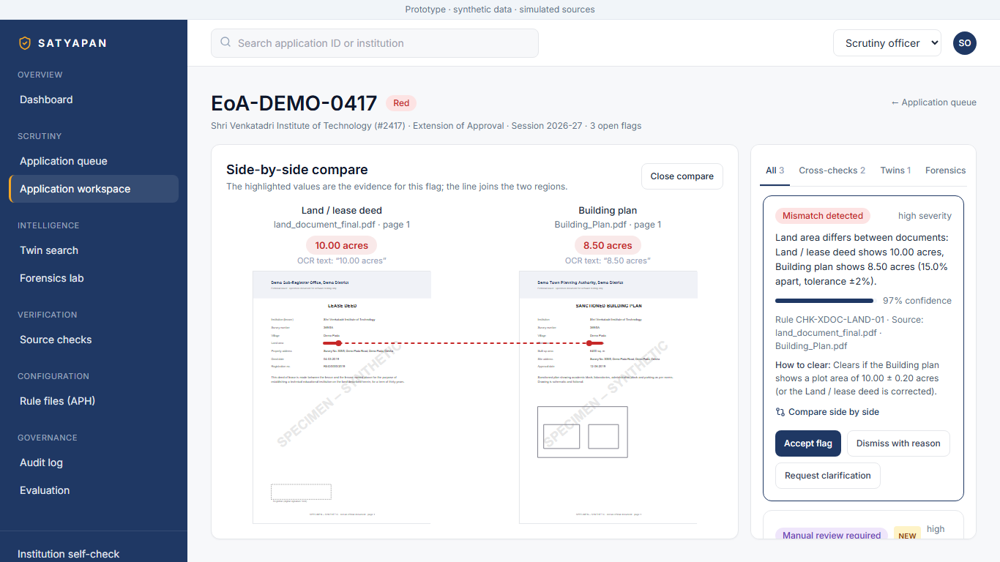

---
title: Satyapan – SIH26261
emoji: 🔍
colorFrom: blue
colorTo: indigo
sdk: docker
app_port: 7860
pinned: false
short_description: Prototype (synthetic data) – Team Innovex_007

# Satyapan: AI pre-scrutiny assistant for AICTE officers (SIH26261)

Satyapan reads every document in an approval application, cross-checks the documents against each other, last year's file and (simulated) issuer records, finds photos reused by *other* institutions, and pins every finding to the exact region of the page, with a confidence score and a "How to clear" hint. **It never approves or rejects: the officer decides** (Accept flag · Dismiss with reason · Request clarification, all written to a hash-chained audit log).

> **Prototype · synthetic data · simulated sources.** Every institution, person and issuer is fictional and every page is watermarked "SPECIMEN – SYNTHETIC". Issuer portals and DigiLocker are lookups against `data/mock_registry.json`, labelled "Simulated source (prototype)". Photos in `data/real_photos/` are sample images.

**Problem statement:** SIH26261, an AI pre-scrutiny assistant that helps AICTE officers check approval applications (Extension of Approval, session 2026-27) for missing, expired, inconsistent or reused documents before human review.

**Demo video:** _link to be added_



## Tech stack

Backend: Python 3.11+, FastAPI, SQLModel/SQLite, pdfplumber, RapidOCR (ONNX, CPU), OpenCV (pHash, ORB + RANSAC, QR), pyHanko. Frontend: React 18, Vite, TypeScript, Tailwind, react-pdf, recharts. Everything runs locally on CPU; no cloud AI.

## Run backend and frontend separately

```powershell
# backend (after setup + seed below), http://localhost:8000/docs
cd backend; .\.venv\Scripts\python -m uvicorn app.main:app --reload --port 8000

# frontend, http://localhost:5173
cd frontend; npm run dev
```

## Test results

`cd backend; .\.venv\Scripts\python -m pytest -q` → **5 passed** (generated-data checks, including every planted defect type). Pipeline evaluation: see the table below.

## Run it (Windows, PowerShell)

Needs Python 3.11+ and Node 20+. From the repo root:

```powershell
# 1. setup (once)
python -m venv backend\.venv
backend\.venv\Scripts\python -m pip install -r backend\requirements.txt
cd frontend; npm install; cd ..

# 2. generate the synthetic dataset, load the DB and run the pipeline (about 8 minutes on CPU)
backend\.venv\Scripts\python -m data.generator.seed --seed 42

# 3. evaluation (fills the Evaluation page)
backend\.venv\Scripts\python eval\evaluate.py

# 4. start the API (:8000) and the UI (:5173), then open the app
.\dev.ps1
start http://localhost:5173      # use "localhost": the dev server binds to IPv6

# between demo runs: clear accepted / dismissed flags and the officer entries in the audit log
.\reset_demo.ps1                 # add -Reseed to rebuild everything from scratch
```

On Linux/macOS the `Makefile` has the same steps (`make setup seed eval dev`, `make shots` for the screenshots).

## What is measured (synthetic data, simulated sources)

| Measure | Result |
|---|---|
| Planted defects found | **51 / 51** across 10 defect types |
| False alarms on the 9 clean applications | **0** |
| Look-alike decoys flagged (same village, different plot) | **0 / 3** |
| Twin photos (re-shot room, real-photo copies, drawn copies) | **9 / 9**, 0 false matches over 15,203 unplanted pairs |
| Document classification | **511 / 511** |
| Fact extraction: text layer / scanned (RapidOCR) | **1819 / 1819**  ·  **81 / 82** |
| Average processing time per application | about 8 s on a laptop CPU |

Run `eval\evaluate.py` for the live numbers; `eval\twin_scan.py` reports the twin detector's margin (keypoint threshold 120 inliers; worst non-twin 83, hero re-shot 212).

## What it checks

Missing documents · expired NOCs · land area and survey number across documents and last year's file · **same land parcel claimed by two institutions** · **impossible timelines** (Fire NOC before plan approval, Sunday issue dates) · twin photos (pHash, then ORB + RANSAC keypoints for "same room, re-shot") · forensic indicators (edit after signing) · duplicate faculty IDs · QR vs printed text · digital-signature status · simulated issuer lookups. Status words are fixed: Verified · Mismatch detected · Expired · Verification pending · Source unavailable · Manual review required. Thresholds live in [backend/app/rules/aph_2026_27.yaml](backend/app/rules/aph_2026_27.yaml).

## Layout

`backend/` FastAPI + SQLite, `app/pipeline` (classify, OCR, extract, checks, simulated sources) · `frontend/` React + Vite + Tailwind · `data/generator` synthetic dataset and `answer_key.json` · `eval/` evaluation · `docs/screenshots/`.

## Roadmap (not built, not tested)

Hindi OCR (needs Tesseract with the `hin` model; the Hindi pages render but are not transcribed) · rule editor · verdict and deficiency-letter PDFs · Docker · CLIP embeddings.
